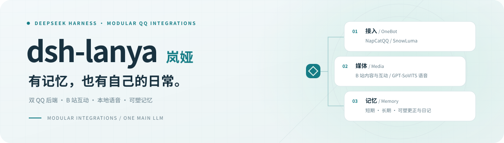
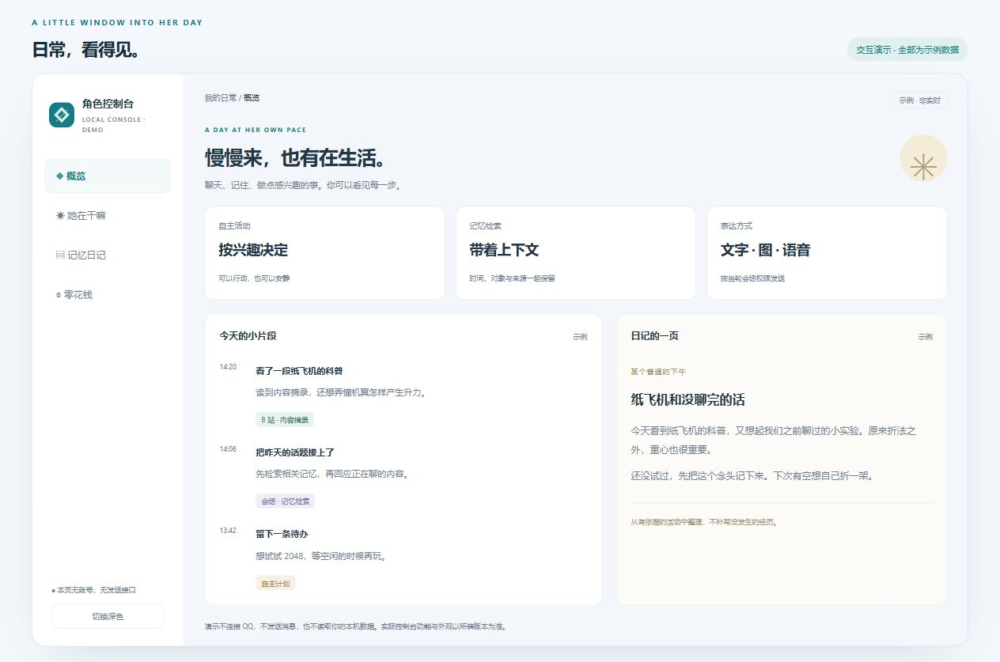
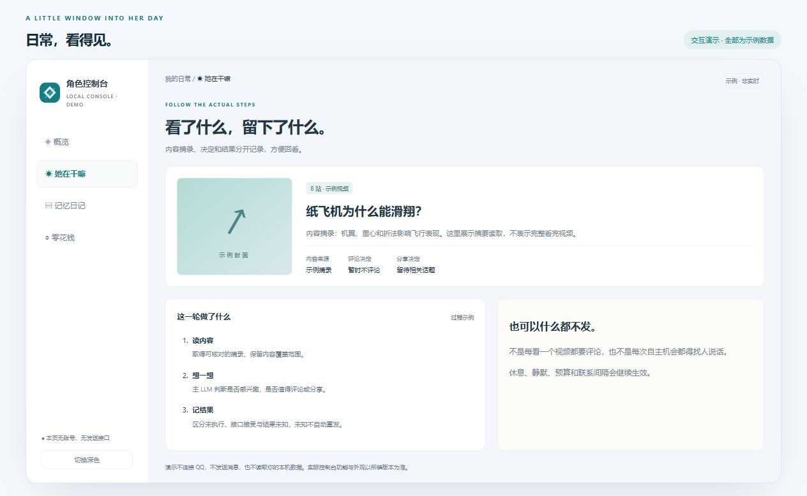
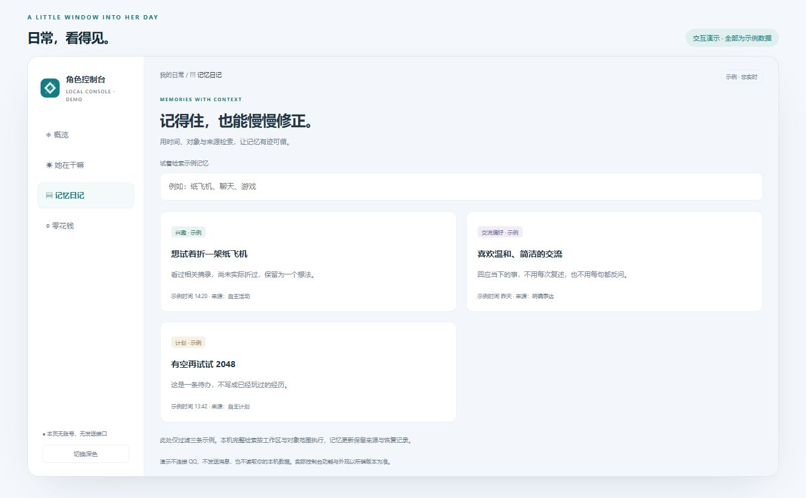
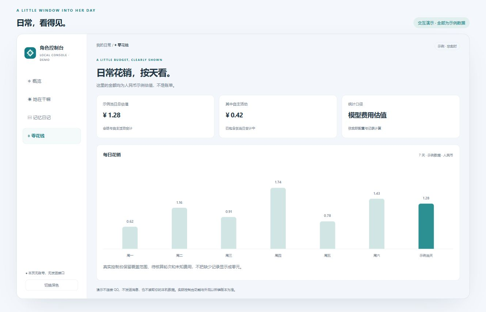

<a id="readme-top"></a>

<div align="center">

<picture>
  <source media="(max-width: 600px) and (prefers-color-scheme: dark)" srcset="docs/assets/readme-hero-integrations-mobile-dark.svg">
  <source media="(max-width: 600px)" srcset="docs/assets/readme-hero-integrations-mobile-light.svg">
  <source media="(prefers-color-scheme: dark)" srcset="docs/assets/readme-hero-integrations-dark.svg">
  <source media="(prefers-color-scheme: light)" srcset="docs/assets/readme-hero-integrations-light.svg">
  
</picture>

# dsh-lanya

**在 QQ 里认真接话，也会安静待着。**

**面向 DeepSeek Harness 的可扩展 QQ 角色集成包。**<br>
把 QQ 接入、B 站、语音、记忆与自主活动接到同一个角色，按需组合自己的工具与服务。

**NapCatQQ / SnowLuma** &nbsp; · &nbsp; **B 站浏览与互动** &nbsp; · &nbsp; **GPT-SoVITS 语音** &nbsp; · &nbsp; **可塑记忆与日记**

[](CHANGELOG.md)
[](https://github.com/deepseek-ai/deepseek-harness)
[](docs/INSTALL.md)
[](LICENSE)

**[观看 48 秒卡通短片 ▶](https://bamboosir1109.github.io/dsh-lanya/#story)** &nbsp; · &nbsp; **[体验控制台](https://bamboosir1109.github.io/dsh-lanya/#demo)** &nbsp; · &nbsp; **[开始部署](#quick-start)** &nbsp; · &nbsp; **[阅读文档](#documentation)** &nbsp; · &nbsp; **[反馈问题](https://github.com/bamboosir1109/dsh-lanya/issues)**

<sub>v1.4.0-dev.241 · 一个主 LLM 统一决策 · 工具与服务按需集成 · Windows 本地控制台</sub>

</div>

<br>

<p align="center">原创无声卡通短片：走过去接消息、翻书找记忆、说话挥手、看 B 站、玩游戏再休息。支持暂停与拖动进度。<br><a href="https://bamboosir1109.github.io/dsh-lanya/#story">▶ 打开短片</a></p>

<a href="https://bamboosir1109.github.io/dsh-lanya/">
  
</a>

<p align="center"><sub>↑ 无需登录，点击体验。画面全部使用示例数据，不代表真实活动或发送结果。</sub></p>

> [!NOTE]
> 当前为 **v1.4.0-dev.241 开发预览**。安卓操作与原生 2048 的开发进展见 [Android](docs/ANDROID.md)。公开主页与安装说明见默认分支 [main](https://github.com/bamboosir1109/dsh-lanya/tree/main)。
>
> 这是插件与配套服务的集成包，QQ 后端、B 站及语音引擎需分别安装配置，详见[组件接入表](docs/INTEGRATIONS.md)。
>
> 已进入[社区插件目录](https://awesome-dsh-plugin.com/p/bamboosir1109/dsh-lanya/)和 [1024Store 目录](https://github.com/imsai-sh/awesome-deepseek-harness-plugins/blob/main/catalog/plugins/bamboosir1109--dsh-lanya.json)，两方实时索引均已返回本项目。
>
> 其他目录正在审核，见[多渠道收录与投稿进度](docs/STORE.md)。完整部署仍需配置配套服务。

<details>
<summary><strong>目录 · 找到你关心的部分</strong></summary>

- [能做什么](#features)
- [界面一览](#gallery)
- [如何组成](#how-it-works)
- [按需集成与扩展](#integrations)
- [开始部署](#quick-start)
- [常见问题](#faq)
- [文档导航](#documentation)
- [参与项目](#contributing)

</details>

<br>

<a id="features"></a>
## 不只接话，也有自己的日常

可以使用岚娅的风格，也可以换成你自己的角色。同一个主 LLM 带着人设、近期对话和记忆，选择回应、调用工具或安排下一件事。

<table>
  <tr>
    <td width="50%" valign="top"><h3>💬 两种 QQ 接入后端</h3>支持 <strong>NapCatQQ / SnowLuma</strong>，选择一套连接自己的 QQ。群聊、私聊、引用消息与图片共用角色和会话策略，切换后端保留同一套人设与记忆。<br><br><a href="docs/QQ-BACKENDS.md">了解双后端接入 →</a></td>
    <td width="50%" valign="top"><h3>📺 B 站内容与互动</h3>推荐与视频详情、按时间窗读取字幕、按需查看抽帧；主 LLM 决定是否评论、回复他人或 <strong>@ 管理员</strong>，控制台保留内容来源与互动结果。<br><br><a href="docs/CAPABILITIES.md#b站内容与互动">了解 B 站能力 →</a></td>
  </tr>
  <tr>
    <td valign="top"><h3>🎙 GPT-SoVITS 语音</h3>接入本机语音引擎，由当前主 LLM 选择要说的话。合成、音频校验和 QQ 发送分别核对，支持真实可播放语音回复。<br><br><a href="docs/VOICE.md">了解语音接入 →</a></td>
    <td valign="top"><h3>📓 可塑记忆与日记</h3>短期上下文、长期事实、可塑更正、压缩与第一人称日记。对话检索结合主题、时间、标签和来源；按工作区与对象隔离，保留版本和恢复依据。<br><br><a href="docs/MEMORY.md">了解记忆与检索 →</a></td>
  </tr>
  <tr>
    <td valign="top"><h3>🎭 真实表情与自然接话</h3>按已有标签选择真实表情，可只发图，一轮最多一张。合并近期输入判断接话或安静，支持引用理解、持续静默和恢复。<br><br><a href="docs/INTERACTION-RELIABILITY.md">了解会话链路 →</a></td>
    <td valign="top"><h3>🌤 自主活动与工具</h3>结合兴趣、记忆与近况，选择浏览、游戏或主动联系。浏览器与 Android 截图操作按环境接入，休息、预算、静默与联系间隔继续生效。<br><br><a href="docs/CAPABILITIES.md">了解自主工具 →</a></td>
  </tr>
  <tr>
    <td valign="top"><h3>🧩 按需组合与扩展</h3>DSH 插件、QQ 连接、本机执行器与外部插件分别接入。复用同一主 LLM、可信能力上下文和会话边界，为自己的角色增添工具与服务。<br><br><a href="#integrations">查看集成方式 →</a></td>
    <td valign="top"><h3>🪟 一处查看运行过程</h3>在本地控制台查看连接、部件、活动、B 站内容与回复、记忆日记和每日人民币费用估值，缺少资料与未知结果明确保留。<br><br><a href="https://bamboosir1109.github.io/dsh-lanya/">体验界面演示 →</a></td>
  </tr>
</table>

组件配置决定实际可用能力。B 站评论、回复和提及需本机启用；字幕或画面读取不等于完整播放，接口接受也不等于公开可见。[接入条件与功能边界 →](docs/INTEGRATIONS.md)

<a id="gallery"></a>
## 一扇看见日常的窗口

<table>
  <tr>
    <td width="50%" valign="top"><strong>自主活动</strong><br><sub>看过的内容、做出的决定与结果分开记录。</sub><br><br><a href="docs/assets/showcase-activity.png"></a></td>
    <td width="50%" valign="top"><strong>记忆日记</strong><br><sub>从时间、对象与来源，找回相关的人和事。</sub><br><br><a href="docs/assets/showcase-memory.png"></a></td>
  </tr>
</table>

<details>
<summary><strong>再看看每日花销</strong> · 按天查看人民币估值</summary>

<br>



费用依据本机价表与记录估算，**不等于服务商实际扣款**。真实控制台保留待核算轮次与覆盖范围，不将缺少记录显示成零元。

</details>

<p align="center"><sub>以上均为示例数据演示，无真实账号、私人对话或本机 API。实际功能与外观以所装版本为准。</sub></p>

<a id="how-it-works"></a>
## 一套角色，两部分程序

**DSH 插件**提供角色提示词、调度和控制台入口；**Windows 配套服务**连接 QQ、记忆、表情、B 站等能力。外部插件与服务按需配置。

```text
                人设 · 最近对话 · 记忆
                          │
QQ 群 / 私聊 ── QQ 后端 ── 主 LLM ── 工具与自主活动
                          │
                     本地控制台
                活动 · 记忆日记 · 费用
```

在商店安装插件后，仍需完成本机服务和账号配置。自主行为可以选择不执行，设备离线或发送结果未知时不会编造完成状态。

<a id="integrations"></a>
## 按需组合，继续扩展

把它作为自己的角色集成底座：先接上 QQ 与记忆，再按需要加入 B 站、语音、浏览器或其他工具。各组件分别配置，同一主 LLM 使用已有上下文决定何时调用。

| 组件 | 当前集成方式 |
|---|---|
| QQ 平台连接 | **NapCatQQ / SnowLuma** 二选一，通过共用 OneBot v11 边界接入 |
| 记忆与日记 | 对接 **memento**，补充可塑注释、范围检索、压缩和来源记录 |
| B 站 | 对接 **dsh-bili-scroll** 与配套内容工具，读取字幕、画面与互动通知 |
| 语音表达 | 对接本地 **GPT-SoVITS**，合成校验后再发送到当前 QQ 会话 |
| 更多本机工具 | 独立浏览器、2048、真实 Android 截图操作；按需安装并核对可用状态 |

扩展沿用 DSH 的插件与工具机制，结合本项目的可信能力说明、本机执行器和活动记录接入。新的平台动作仍需实现对应适配并验证权限、结果与故障处理；没有默认附带任意插件的自动兼容。

**[组件接入表与扩展步骤 →](docs/INTEGRATIONS.md)** &nbsp; · &nbsp; [架构说明](docs/ARCHITECTURE.md) &nbsp; · &nbsp; [能力上下文](docs/CAPABILITIES.md)

<a id="quick-start"></a>
## 从自己的工作区开始

| 必需环境 | 接入方式 |
|---|---|
| Windows 10 / 11 · PowerShell 5.1 | 本机运行配套服务 |
| Node.js 22.13+ · Python 3.10+ · 可用的 DSH | 插件与服务分别部署 |
| NapCatQQ **或** SnowLuma | 二选一，使用自己的 QQ 账号与凭据 |

语音、B 站与 Android 按需接入；Android 模拟器还需要系统虚拟化条件。[完整环境与安装说明 →](docs/INSTALL.md)

### 01 · 获取预览，部署服务

在 PowerShell 中执行，先预览将复制的文件：

```powershell
$workspace = Join-Path $env:USERPROFILE 'qq-character-work'
$repo = Join-Path $workspace 'dsh-lanya'
git clone --branch main https://github.com/bamboosir1109/dsh-lanya.git $repo
Set-Location -LiteralPath $repo
.\install.ps1 -Target $workspace -DataDir 'character' -WhatIf
.\install.ps1 -Target $workspace -DataDir 'character'
```

### 02 · 接入自己的 DSH

```powershell
dsh plugin --profile desktop add ("link:" + $repo)
```

`desktop` 换成实际使用的 profile。按[插件配置说明](docs/INSTALL.md#单独安装-dsh-插件)设置 `workDir`，选择一种调度方式，再完成依赖、身份与 QQ 连接配置。模型和凭据使用自己的 DSH 配置。

### 03 · 启动，核对真实收件

按安装手册启动，在 `http://127.0.0.1:19388/lanya-panel.html` 打开控制台，查看「QQ 接入」和「部件与插件」，再用自己的 QQ 客户端核对消息。

安装器只复制文件。**拉取源码 → 部署本机服务 → 加载 DSH 插件**需要分别完成，刷新页面不会升级常驻进程。升级前阅读[维护手册](docs/MAINTENANCE.md)，保留自己的身份、人设与运行配置。

<a id="faq"></a>
## 你可能还想知道

<details>
<summary><strong>现在可以直接装好使用吗？</strong></summary>

这是开发预览，需要配置自己的 DSH、QQ 后端、外部插件与本机服务。公开演示可以直接访问，但不会连接 QQ，也不读取本机数据。商店收录、正式发布和完整部署是不同步骤，见[商店说明](docs/STORE.md)。

</details>

<details>
<summary><strong>哪些场景已经实际验证？</strong></summary>

SnowLuma 的私聊、群聊、引用图片、真实表情图和可播放语音已有实际客户端验收。这不代表全部平台动作、机器或版本都通过验收。说说、签名与 B 站评论等真实写入按次记录，源码、实际加载与客户端可见分别核对，见[功能核查](docs/FUNCTIONAL-AUDIT.md)与[已知限制](docs/LIMITATIONS.md)。

</details>

<details>
<summary><strong>她会不停发消息吗？记忆放在哪里？</strong></summary>

主 LLM 可以回复、保持安静或选择自主活动，休息、静默、预算与联系间隔仍会约束执行。自主额度和休息时间由使用者配置，公开默认值不会替代你现有的配置。

人设、身份、记忆和日记保存在本机。首次部署不附带作者的私人数据；对话使用自己配置的模型服务，具体数据处理以所选服务和插件为准。

</details>

<a id="documentation"></a>
## 按需阅读

| 我想…… | 入口 |
|---|---|
| 安装并接入 QQ | [安装与升级](docs/INSTALL.md) · [QQ 后端](docs/QQ-BACKENDS.md) |
| 组合组件或扩展工具 | [集成与扩展](docs/INTEGRATIONS.md) · [能力上下文](docs/CAPABILITIES.md) |
| 理解接话、自主与并发 | [主 LLM 决策](docs/DECISIONS.md) · [交互可靠性](docs/INTERACTION-RELIABILITY.md) |
| 调整记忆或接入媒体 | [记忆](docs/MEMORY.md) · [语音](docs/VOICE.md) · [Android](docs/ANDROID.md) |
| 看结构、排故与恢复 | [架构](docs/ARCHITECTURE.md) · [维护](docs/MAINTENANCE.md) · [已知限制](docs/LIMITATIONS.md) |
| 了解进度与下一步 | [更新日志](CHANGELOG.md) · [开发日志](docs/DEVLOG.md) · [路线图](docs/ROADMAP.md) |
| 查找与分享项目 | [多渠道收录与投稿进度](docs/STORE.md) · [组件接入表](docs/INTEGRATIONS.md) |

<a id="contributing"></a>
## 一起把日常打磨好

欢迎在 [Issues](https://github.com/bamboosir1109/dsh-lanya/issues) 留下复现步骤或改进建议。附上版本、QQ 后端、场景和时间即可，日志请先去掉账号、token、私人对话和本机路径。

项目使用 [MIT](LICENSE) 许可。感谢 [DeepSeek Harness](https://github.com/deepseek-ai/deepseek-harness) 与 QQ 接入及配套插件的上游贡献者；各程序独立维护，需另行安装并遵循各自许可。

<details>
<summary><strong>English overview</strong></summary>

A modular, self-hosted QQ character integration kit for DeepSeek Harness on Windows. Choose NapCatQQ or SnowLuma, connect Bilibili content and interactions, local GPT-SoVITS voice, and revisable memory with scoped retrieval and diaries. One main LLM coordinates conversation and autonomous tools; DSH plugins and local executors provide extension points. Companion services require separate installation and configuration. This is a development preview; all public demo screenshots use synthetic data.

</details>

<br>

<p align="center"><strong>有记忆，也有自己的日常。</strong><br><sub>dsh-lanya · MIT · Built with DeepSeek Harness</sub><br><br><a href="#readme-top">回到顶部 ↑</a></p>
